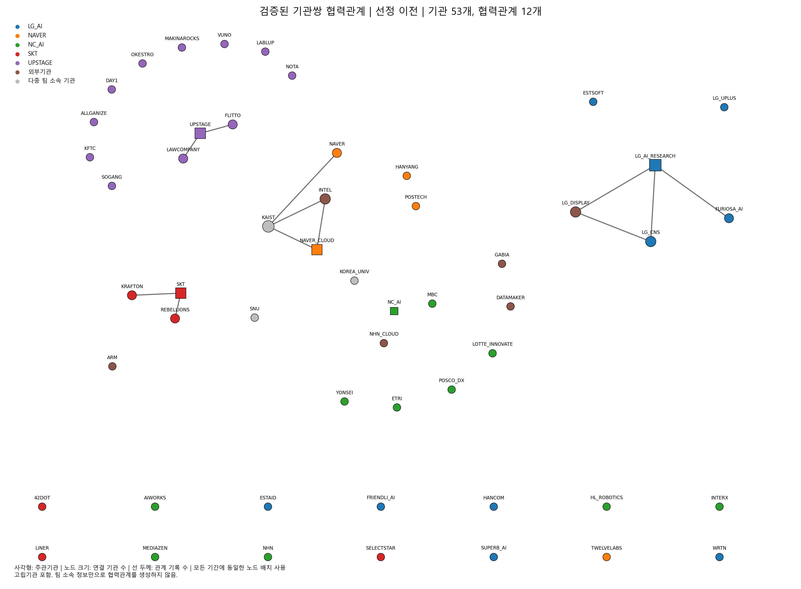
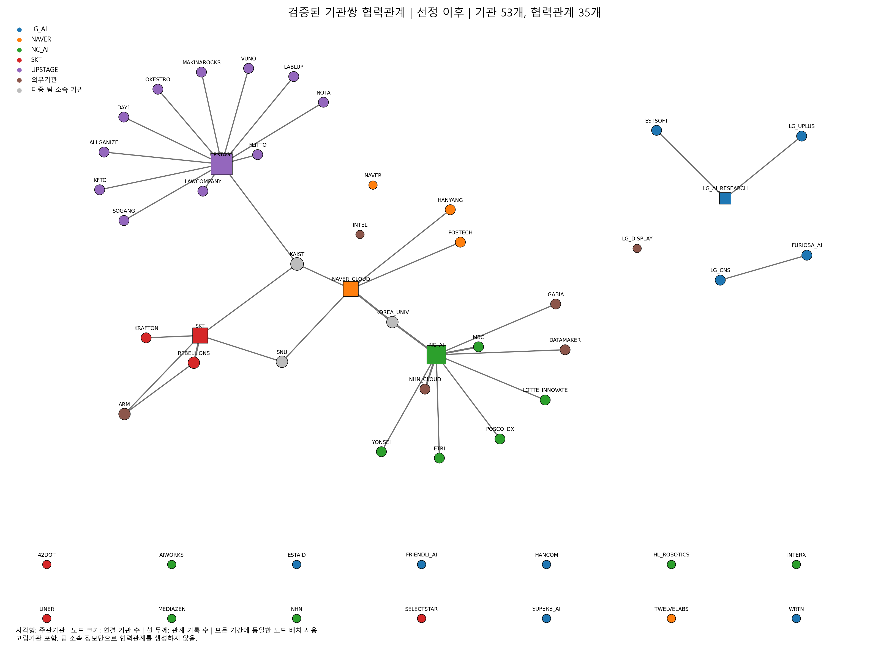
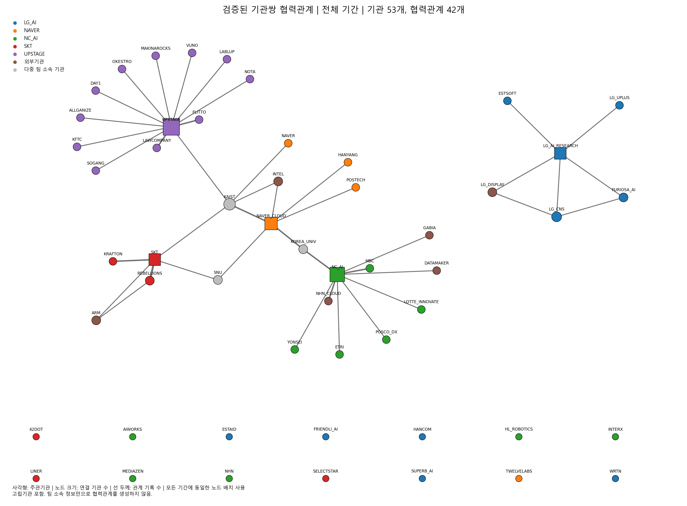

# 검증된 기관쌍 협력관계 네트워크 분석

이 연구는 **컨소시엄 명단이 아니라 검증된 기관쌍 협력관계**를 분석한다. DARPA형 자율적 컨소시엄 구성 아래 독파모 참여기관의 관측 가능한 기술협력 구조를 기술한다. 입력 CSV의 relation record를 직접협업 근거로 받아들였으며 원문 웹자료를 재검증하거나 추가 자료를 수집하지 않았다.

## A. 데이터 검증과 분석 범위

기관 53개, 관계 기록 52개, 출처 ID 28개. 필수값·ID 유일성·관계 내용 중복·기관 및 출처 참조·자기연결 부재·근거수준·팀 플래그·기간 일치를 검증했다. 날짜와 출처 날짜 불일치 0건, Unicode 대체문자 0개. 동일 URL을 공유하는 출처 ID 묶음: [['S015', 'S016']]. 같은 URL 또는 같은 출처의 복수 기록은 독립적인 증거의 수를 의미하지 않는다. 입력 해시는 데이터_검증_결과.json에 보존했다.

pre는 2025-08-04 미만, during은 당일 이상이다. 기간은 관계 기록의 날짜를 분류한 관측 창이며 협력의 실제 시작·종료 또는 지속 여부를 확정하지 않는다. pre/during 관측 기간 길이는 동일하지 않으며 발생률로 비교하지 않는다. 외부기관도 master에 있으면 포함한다. 모든 전체 그래프는 고립기관을 포함한 동일 기관 집합을 사용한다. 팀 소속은 제공된 정적 메타데이터이며 pre 시점 소속의 역사적 복원이 아니다.

## B–C. 네트워크 구조

관측 edge는 pre 12개에서 during 35개로, 최대 연결요소는 4개 기관에서 31개 기관으로 달라진다. 반면 평균 clustering은 약 0.0881에서 0.0396으로 낮아진다. 이는 관측 연결의 확대와 삼각형 폐쇄 정도가 같은 방향으로 움직이지 않음을 보여준다. all에서는 42개 고유 기관쌍이 확인된다.

| period   |   nodes |   active_nodes |   edges |   relation_records |   density |   components |   isolates |   largest_component |   average_clustering |
|:---------|--------:|---------------:|--------:|-------------------:|----------:|-------------:|-----------:|--------------------:|---------------------:|
| pre      |      53 |             14 |      12 |                 12 |    0.0087 |           43 |         39 |                   4 |               0.0881 |
| during   |      53 |             36 |      35 |                 40 |    0.0254 |           20 |         17 |                  31 |               0.0396 |
| all      |      53 |             39 |      42 |                 52 |    0.0305 |           16 |         14 |                  33 |               0.1157 |

무방향 단순 그래프에서 기관쌍별 weight는 해당 기간 relation record 수다. all은 원시 기록의 합집합을 집계한다. 동일 소속이나 다자행사 참여만으로 edge를 생성하지 않았다. degree는 이웃 수, weighted degree는 기록 수 합이다. betweenness는 정규화하고 거리=1/weight를 사용한다. closeness는 같은 거리와 NetworkX의 WF 도달가능성 보정을 적용하므로 비연결성을 반영하지만 강한 edge는 값이 1을 넘게 할 수도 있다. 비교용 무가중 betweenness/closeness도 제공한다. clustering은 무가중 및 NetworkX의 최대 가중치 정규화 방식 모두 제공한다. density는 무가중 edge 수 / 가능한 기관쌍 수이며, 평균 clustering은 고립기관을 포함한다. components에는 고립기관도 포함한다. 가중치는 협력 품질·투입량·독립 출처 수를 뜻하지 않는다.

## D. 주관기관 중심성

| period   | node_id        |   degree |   weighted_degree |   betweenness |   closeness |
|:---------|:---------------|---------:|------------------:|--------------:|------------:|
| pre      | NAVER_CLOUD    |        2 |                 2 |        0.0000 |      0.0433 |
| pre      | UPSTAGE        |        2 |                 2 |        0.0008 |      0.0385 |
| pre      | SKT            |        2 |                 2 |        0.0008 |      0.0385 |
| pre      | NC_AI          |        0 |                 0 |        0.0000 |      0.0000 |
| pre      | LG_AI_RESEARCH |        3 |                 3 |        0.0015 |      0.0577 |
| during   | NAVER_CLOUD    |        5 |                 6 |        0.1836 |      0.2622 |
| during   | UPSTAGE        |       12 |                12 |        0.1991 |      0.2473 |
| during   | SKT            |        5 |                 6 |        0.0675 |      0.2060 |
| during   | NC_AI          |        9 |                12 |        0.1538 |      0.2219 |
| during   | LG_AI_RESEARCH |        2 |                 2 |        0.0008 |      0.0385 |
| all      | NAVER_CLOUD    |        6 |                 8 |        0.2081 |      0.3376 |
| all      | UPSTAGE        |       12 |                14 |        0.2157 |      0.3014 |
| all      | SKT            |        5 |                 8 |        0.0671 |      0.2467 |
| all      | NC_AI          |        9 |                12 |        0.1659 |      0.2722 |
| all      | LG_AI_RESEARCH |        5 |                 5 |        0.0057 |      0.0962 |

각 지표는 전체 53개 기관을 기준으로 산출하며, 주관기관의 기간별 기록상 위치를 비교한다. 높은 degree는 확인된 상대기관이 많음을 뜻하며 실제 영향력이나 사업 성과의 직접 측정은 아니다.

## E. 수평적 관계

| period   |   horizontal_edges |   edges |   horizontal_edge_ratio |   horizontal_record_ratio |
|:---------|-------------------:|--------:|------------------------:|--------------------------:|
| pre      |                  3 |      12 |                  0.2500 |                    0.2500 |
| during   |                  2 |      35 |                  0.0571 |                    0.0500 |
| all      |                  5 |      42 |                  0.1190 |                    0.0962 |

horizontal은 양 끝점 모두 master의 is_lead=0인 edge다. 분모는 외부기관을 포함한 전체 관측 edge 수이며, 기록가중 비율도 별도로 제시한다. 외부기관도 비주관기관으로 포함되므로 이 비율은 컨소시엄 내부 구성원 사이의 수평협력 비율과 동일하지 않다.

## F. 다중 팀 기관의 brokerage

baseline during에서 KAIST의 가중 betweenness는 약 0.1825, 고려대학교는 0.1425, SNU는 0.0196이다. strict during에서는 KAIST와 SNU가 고립되고 고려대학교는 약 0.0045로 낮아진다. 따라서 다중 팀 기관의 관측 중개 위치는 수준 2 역할협업 기록의 포함 여부에 민감하다. 다중 소속 자체가 강한 직접 공동개발 관계를 보장하지 않는다.

| period   | node_id    |   degree |   betweenness |   constraint |   open_neighbor_pairs |   cross_team_open_neighbor_pairs | articulation_point   |
|:---------|:-----------|---------:|--------------:|-------------:|----------------------:|---------------------------------:|:---------------------|
| pre      | SNU        |        0 |        0.0000 |     nan      |                     0 |                                0 | False                |
| pre      | KAIST      |        3 |        0.0015 |       0.6111 |                     2 |                                0 | True                 |
| pre      | KOREA_UNIV |        0 |        0.0000 |     nan      |                     0 |                                0 | False                |
| during   | SNU        |        2 |        0.0196 |       0.5000 |                     1 |                                1 | False                |
| during   | KAIST      |        3 |        0.1825 |       0.3333 |                     3 |                                3 | True                 |
| during   | KOREA_UNIV |        2 |        0.1425 |       0.5000 |                     1 |                                1 | True                 |
| all      | SNU        |        2 |        0.0000 |       0.5000 |                     1 |                                1 | False                |
| all      | KAIST      |        5 |        0.2376 |       0.3003 |                     9 |                                5 | True                 |
| all      | KOREA_UNIV |        2 |        0.1561 |       0.5000 |                     1 |                                1 | True                 |

multi_team 자체는 연결 근거가 아니다. open_neighbor_pairs는 해당 기관의 이웃 중 서로 직접 연결되지 않은 쌍 수다. cross_team은 두 이웃의 비외부 팀 집합이 모두 비어 있지 않고 서로 겹치지 않는 경우만 센다. 단순 팀 수를 중개로 간주하지 않는다. constraint는 기록가중 Burt constraint이며 고립기관은 결측이다. articulation은 제거 시 연결요소를 분리하는 위상적 위치로, 실제 지식흐름이나 인과적 매개를 입증하지 않는다. 제거 후 원래 소속 연결요소의 잔여 조각 수를 CSV에 제공한다.

## G. 기관쌍 transition

{'newly_observed_during': 30, 'pre_only': 7, 'persisted': 5}

persisted는 두 기간 모두 기록이 관측된 기관쌍, pre_only는 pre에만 기록된 기관쌍, newly_observed_during은 during에만 기록된 기관쌍이다. 후자는 **newly observed after selection**으로만 해석한다. persisted는 지속 활동의 입증이 아니고 pre_only는 협력 종료의 입증이 아니다. 새 관측 관계를 독파모 선정의 인과효과로 표현할 수 없다.

## H. 팀별 유도 부분그래프

| period   | team    |   nodes |   edges |   density |   components |   horizontal_edge_ratio |   boundary_edges |
|:---------|:--------|--------:|--------:|----------:|-------------:|------------------------:|-----------------:|
| pre      | LG_AI   |      10 |       2 |    0.0444 |            8 |                  0.0000 |                2 |
| pre      | NAVER   |       8 |       2 |    0.0714 |            6 |                  0.5000 |                2 |
| pre      | NC_AI   |      14 |       0 |    0.0000 |           14 |                nan      |                3 |
| pre      | SKT     |       8 |       2 |    0.0714 |            6 |                  0.0000 |                3 |
| pre      | UPSTAGE |      13 |       2 |    0.0256 |           11 |                  0.0000 |                3 |
| during   | LG_AI   |      10 |       3 |    0.0667 |            7 |                  0.3333 |                0 |
| during   | NAVER   |       8 |       5 |    0.1786 |            3 |                  0.0000 |                4 |
| during   | NC_AI   |      14 |       6 |    0.0659 |            8 |                  0.0000 |                9 |
| during   | SKT     |       8 |       4 |    0.1429 |            4 |                  0.0000 |                5 |
| during   | UPSTAGE |      13 |      12 |    0.1538 |            1 |                  0.0000 |                2 |
| all      | LG_AI   |      10 |       5 |    0.1111 |            6 |                  0.2000 |                2 |
| all      | NAVER   |       8 |       6 |    0.2143 |            2 |                  0.1667 |                6 |
| all      | NC_AI   |      14 |       6 |    0.0659 |            8 |                  0.0000 |               11 |
| all      | SKT     |       8 |       4 |    0.1429 |            4 |                  0.0000 |                7 |
| all      | UPSTAGE |      13 |      12 |    0.1538 |            1 |                  0.0000 |                4 |

양 끝점이 해당 팀 명단에 있는 관측 edge만 포함한다. 다중 팀 기관은 각 팀에 중복 포함되어 팀별 결과를 합산하면 전체와 일치하지 않는다. 외부기관은 팀 내부 그래프에서 제외하며 boundary_edges는 팀 안팎을 잇는 관측 edge다. 팀 크기·고립기관 구성·공개 보도량이 달라 단순 순위는 성과 순위가 아니다.

## I. evidence_level=3 엄격 민감도 분석

strict during의 edge는 18개로 baseline 35개의 약 51.4%가 유지된다. 연결요소는 20개에서 36개로 늘어난다. pre의 12개 edge는 모두 수준 3으로 유지된다. 기간 차이의 일부는 수준 2 역할협업 기록에 의존하며, 강한 근거만으로도 during edge가 pre보다 많다는 관측과 함께 해석해야 한다.

| period   |   edges |   relation_records |   edge_retention |   density |   components |   horizontal_edge_ratio |   average_clustering |
|:---------|--------:|-------------------:|-----------------:|----------:|-------------:|------------------------:|---------------------:|
| pre      |      12 |                 12 |           1.0000 |    0.0087 |           43 |                  0.2500 |               0.0881 |
| during   |      18 |                 21 |           0.5143 |    0.0131 |           36 |                  0.1111 |               0.0440 |
| all      |      27 |                 33 |           0.6429 |    0.0196 |           30 |                  0.1852 |               0.1296 |

수준 3은 직접 공동개발·공동연구·실증 명시, 수준 2는 구체적 역할협업 확인이다. 엄격 분석은 기록 단위로 수준 2를 제거한 뒤 기관쌍을 다시 집계한다. 같은 쌍의 수준 3 기록이 남으면 edge도 남는다. node_metrics, network_summary, team_summary, broker_analysis, relation_type_summary에는 baseline과 strict를 모두 제공한다. 수준 2 제거로 달라지는 연결성·주관기관 중심성·다중 팀 중개를 함께 검토해야 하며 명단에 있는 기관의 실제 비협력을 추정해서는 안 된다.

## J. relation_type별 네트워크·빈도

| relation_type         |   relation_records |   edges |   active_nodes |   unique_sources |   density |   components |
|:----------------------|-------------------:|--------:|---------------:|-----------------:|----------:|-------------:|
| AI반도체_공동연구     |                  1 |       1 |              2 |                1 |    0.0007 |           52 |
| 공동R&D               |                  4 |       4 |              5 |                2 |    0.0029 |           49 |
| 공동연구센터          |                  4 |       4 |              4 |                2 |    0.0029 |           50 |
| 데이터_공동개발       |                  1 |       1 |              2 |                1 |    0.0007 |           52 |
| 독파모_AX확산         |                  1 |       1 |              2 |                1 |    0.0007 |           52 |
| 독파모_검색글로벌     |                  1 |       1 |              2 |                1 |    0.0007 |           52 |
| 독파모_데이터협업     |                  1 |       1 |              2 |                1 |    0.0007 |           52 |
| 독파모_도메인협업     |                  4 |       4 |              5 |                2 |    0.0029 |           49 |
| 독파모_모델개발       |                  1 |       1 |              2 |                1 |    0.0007 |           52 |
| 독파모_산업실증       |                  1 |       1 |              2 |                1 |    0.0007 |           52 |
| 독파모_산학공동연구   |                  9 |       9 |              9 |                3 |    0.0065 |           45 |
| 독파모_인프라협업     |                  2 |       2 |              4 |                2 |    0.0015 |           51 |
| 독파모_최적화         |                  1 |       1 |              2 |                1 |    0.0007 |           52 |
| 모델_공동개발         |                  2 |       2 |              4 |                2 |    0.0015 |           51 |
| 미디어_AI협업         |                  1 |       1 |              2 |                1 |    0.0007 |           52 |
| 산업_공동개발         |                  3 |       3 |              4 |                1 |    0.0022 |           50 |
| 상용_기술협업         |                  1 |       1 |              2 |                1 |    0.0007 |           52 |
| 생성형AI_공동개발     |                  3 |       3 |              3 |                1 |    0.0022 |           51 |
| 서비스_기술협업       |                  1 |       1 |              2 |                1 |    0.0007 |           52 |
| 온디바이스AI_공동개발 |                  1 |       1 |              2 |                1 |    0.0007 |           52 |
| 인프라_공동개발       |                  3 |       3 |              3 |                1 |    0.0022 |           51 |
| 인프라_공동사업       |                  1 |       1 |              2 |                1 |    0.0007 |           52 |
| 인프라_실증           |                  1 |       1 |              2 |                1 |    0.0007 |           52 |
| 피지컬AI_공동연구     |                  2 |       2 |              3 |                1 |    0.0015 |           51 |
| 피지컬AI_실증협업     |                  2 |       2 |              3 |                1 |    0.0015 |           51 |

CSV에는 각 유형의 pre/during/all 및 strict 빈도와 부분네트워크 지표를 제공한다. 유형별로 기록을 필터링한 뒤 동일 기관쌍을 합친다. 하나의 기관쌍이 여러 유형에 속할 수 있어 유형별 edge 수를 전체 edge 수와 합산하지 않는다. 유형 명칭은 입력값 그대로 유지했다.

## K. 해석 한계

공개자료 selection bias 때문에 보도·공시가 많은 기관과 협업이 과대표집될 수 있다. 미관측 edge는 관계 부재가 아니다. 검증된 기록이라는 데이터 정의는 원문 자체의 완전성·정확성에 대한 독립 감사와 다르다. 동일 발표에서 추출한 기록들은 서로 의존하며 가중치는 공개 기록의 반복성도 반영한다. 선정 전후의 노출시간·공개 관행·기관별 홍보 차이를 통제하지 않았고 비교집단도 없으므로 DARPA형 구성이나 선정의 인과효과를 추정하지 않는다. 본 결과는 공급된 세 CSV에 한정된 기술적 네트워크 비교다.

## 향후 R 텍스트 역량 분석 결합

기관별_역량_입력_양식.csv는 기관 ID별 7개 역량 값이 모두 비어 있다. 임의 역량값, 유사도, 우세 역량 또는 역량 간 관계를 생성하지 않았다. 연구자가 공통 척도로 모든 값을 입력하고 명시적으로 --capability-profile을 전달했을 때만 함수가 계산된다. 결측·무한·음수·영벡터는 오류로 중단한다. cosine은 모든 기관쌍의 속성 유사도이며 새로운 협력 edge가 아니다. dominant는 공동 최댓값을 모두 유지한다. cross-capability linkage는 기존 edge의 두 끝점 우세역량 집합이 겹치지 않는 경우다. team coverage는 역량별 양수 점수 구성원 비율과 평균점수이며 팀 구성원 중복을 허용한다. 텍스트 코딩·척도 정규화·양수의 의미를 별도로 문서화한 후 사용해야 한다.

세 그림은 all 그래프의 연결요소별 Kamada–Kawai 좌표를 공통으로 사용하고 all 고립기관은 하단에 배치한다. 연결요소별 화면 배율은 다르다. 선 두께는 기록 수, 노드 크기는 각 기간 degree, 사각형은 주관기관, 회색은 다중 팀 기관이다. 좌표는 관계의 관측 날짜나 실제 지리적 위치를 뜻하지 않는다.
