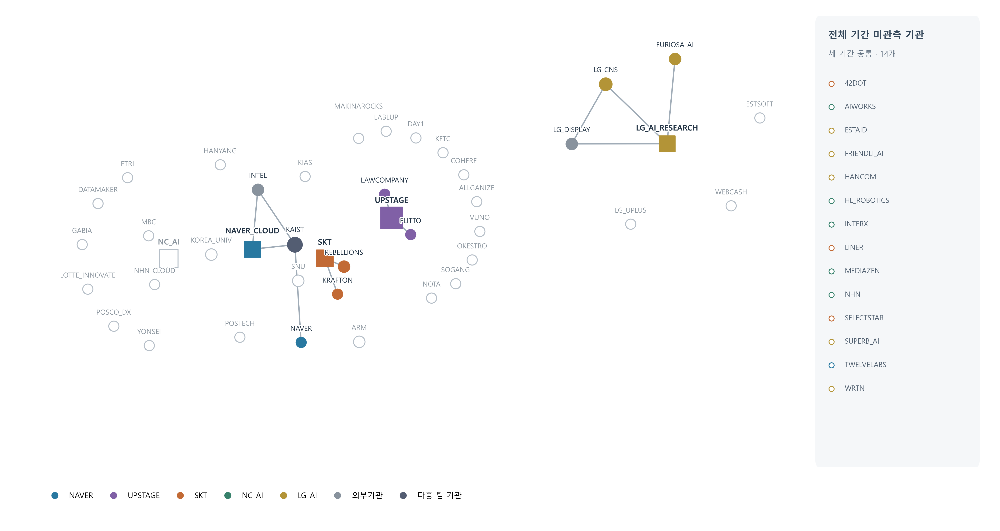
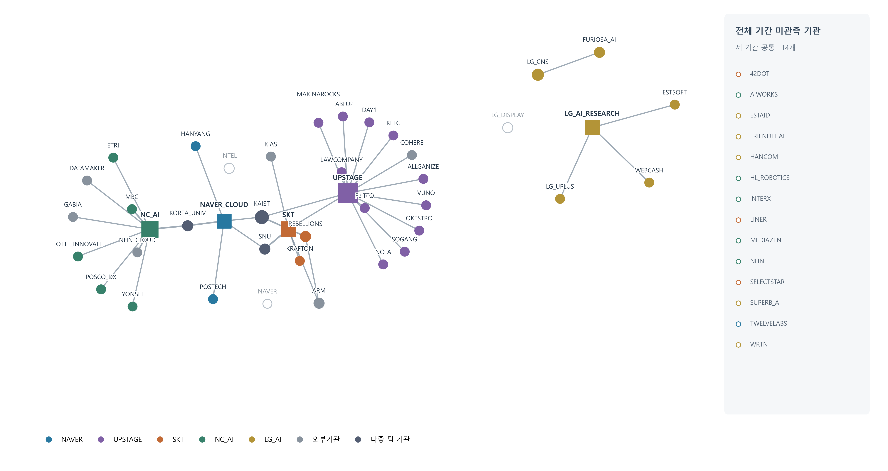
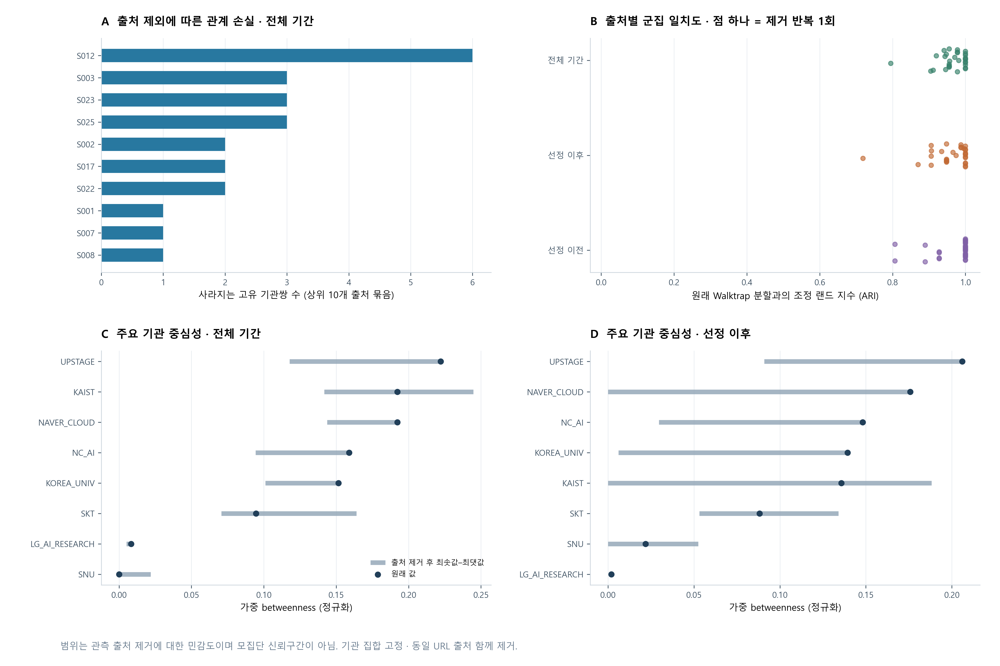

# 검증된 기관쌍 협력관계 네트워크 분석

이 연구는 컨소시엄 명단이 아니라 검증된 기관쌍 협력관계를 분석한다. DARPA형 자율적 컨소시엄 구성 아래 독파모 참여기관의 관측 가능한 기술협력 구조를 기술한다. 입력 CSV의 relation record를 직접협업 근거로 받아들였으며 원문 웹자료를 재검증하거나 추가 자료를 수집하지 않았다.

## A. 데이터 검증과 분석 범위

기관 56개, 관계 기록 58개, 출처 ID 32개. 필수값·ID 유일성·관계 내용 중복·기관 및 출처 참조·자기연결 부재·근거수준·팀 플래그·기간 일치를 검증했다. 날짜와 출처 날짜 불일치 1건, Unicode 대체문자 0개. 동일 URL을 공유하는 출처 ID 묶음: [['S015', 'S016']]. 같은 URL 또는 같은 출처의 복수 기록은 독립적인 증거의 수를 의미하지 않는다. 입력 해시는 데이터_검증_결과.json에 보존했다.

pre는 2025-08-04 미만, during은 당일 이상이다. 기간은 관계 기록의 날짜를 분류한 관측 창이며 협력의 실제 시작·종료 또는 지속 여부를 확정하지 않는다. pre/during 관측 기간 길이는 동일하지 않으며 발생률로 비교하지 않는다. 외부기관도 master에 있으면 포함한다. 모든 전체 그래프는 고립기관을 포함한 동일 기관 집합을 사용한다. 팀 소속은 제공된 정적 메타데이터이며 pre 시점 소속의 역사적 복원이 아니다.

날짜 불일치 상세: R053 / S029: 관계 날짜 2026-10-07, 출처 날짜 2026-10-08. 두 날짜는 서로 다른 사건일·발표일일 수 있으므로 임의 수정하지 않았다. 기간 분류에는 관계 기록의 날짜를 사용한다.

## B–C. 네트워크 구조

관측 edge는 pre 12개, during 39개이며, 최대 연결요소는 각각 4개 기관과 33개 기관이다. 평균 clustering은 각각 0.0833와 0.0436다. all에서는 46개 고유 기관쌍이 확인된다. 연결 범위와 삼각형 폐쇄 정도를 구분해 해석한다.

| period   |   nodes |   active_nodes |   edges |   relation_records |   density |   components |   isolates |   largest_component |   average_clustering |
|:---------|--------:|---------------:|--------:|-------------------:|----------:|-------------:|-----------:|--------------------:|---------------------:|
| pre      |      56 |             14 |      12 |                 12 |    0.0078 |           46 |         42 |                   4 |               0.0833 |
| during   |      56 |             39 |      39 |                 46 |    0.0253 |           20 |         17 |                  33 |               0.0436 |
| all      |      56 |             42 |      46 |                 58 |    0.0299 |           16 |         14 |                  35 |               0.1102 |

무방향 단순 그래프에서 기관쌍별 weight는 해당 기간 relation record 수다. all은 원시 기록의 합집합을 집계한다. 동일 소속이나 다자행사 참여만으로 edge를 생성하지 않았다. degree는 이웃 수, weighted degree는 기록 수 합이다. betweenness는 정규화하고 거리=1/weight를 사용한다. closeness는 같은 거리와 NetworkX의 WF 도달가능성 보정을 적용하므로 비연결성을 반영하지만 강한 edge는 값이 1을 넘게 할 수도 있다. 비교용 무가중 betweenness/closeness도 제공한다. clustering은 무가중 및 NetworkX의 최대 가중치 정규화 방식 모두 제공한다. density는 무가중 edge 수 / 가능한 기관쌍 수이며, 평균 clustering은 고립기관을 포함한다. components에는 고립기관도 포함한다. 가중치는 협력 품질·투입량·독립 출처 수를 뜻하지 않는다.

## D. 주관기관 중심성

| period   | node_id        |   degree |   weighted_degree |   betweenness |   closeness |
|:---------|:---------------|---------:|------------------:|--------------:|------------:|
| pre      | NAVER_CLOUD    |        2 |                 2 |        0.0000 |      0.0409 |
| pre      | UPSTAGE        |        2 |                 2 |        0.0007 |      0.0364 |
| pre      | SKT            |        2 |                 2 |        0.0007 |      0.0364 |
| pre      | NC_AI          |        0 |                 0 |        0.0000 |      0.0000 |
| pre      | LG_AI_RESEARCH |        3 |                 3 |        0.0013 |      0.0545 |
| during   | NAVER_CLOUD    |        5 |                 6 |        0.1758 |      0.2679 |
| during   | UPSTAGE        |       14 |                14 |        0.2061 |      0.2758 |
| during   | SKT            |        7 |                10 |        0.0882 |      0.2758 |
| during   | NC_AI          |        9 |                12 |        0.1481 |      0.2230 |
| during   | LG_AI_RESEARCH |        3 |                 3 |        0.0020 |      0.0545 |
| all      | NAVER_CLOUD    |        6 |                 8 |        0.1923 |      0.3455 |
| all      | UPSTAGE        |       14 |                16 |        0.2222 |      0.3319 |
| all      | SKT            |        7 |                12 |        0.0946 |      0.3372 |
| all      | NC_AI          |        9 |                12 |        0.1589 |      0.2736 |
| all      | LG_AI_RESEARCH |        6 |                 6 |        0.0084 |      0.1091 |

각 지표는 전체 56개 기관을 기준으로 산출하며, 주관기관의 기간별 기록상 위치를 비교한다. 높은 degree는 확인된 상대기관이 많음을 뜻하며 실제 영향력이나 사업 성과의 직접 측정은 아니다.

## E. 수평적 관계

| period   |   horizontal_edges |   edges |   horizontal_edge_ratio |   horizontal_record_ratio |
|:---------|-------------------:|--------:|------------------------:|--------------------------:|
| pre      |                  3 |      12 |                  0.2500 |                    0.2500 |
| during   |                  2 |      39 |                  0.0513 |                    0.0435 |
| all      |                  5 |      46 |                  0.1087 |                    0.0862 |

horizontal은 양 끝점 모두 master의 is_lead=0인 edge다. 분모는 외부기관을 포함한 전체 관측 edge 수이며, 기록가중 비율도 별도로 제시한다. 외부기관도 비주관기관으로 포함되므로 이 비율은 컨소시엄 내부 구성원 사이의 수평협력 비율과 동일하지 않다.

## F. 다중 팀 기관의 brokerage

선정 이후 다중 팀 기관의 근거수준별 비교: SNU: baseline betweenness=0.0219、degree=2; strict betweenness=0.0000、degree=1 / KAIST: baseline betweenness=0.1357、degree=3; strict betweenness=0.0000、degree=1 / KOREA_UNIV: baseline betweenness=0.1394、degree=2; strict betweenness=0.0040、degree=2. 수준 2 역할협업 기록의 포함 여부에 따른 차이를 함께 확인해야 한다. 다중 소속 자체가 강한 직접 공동개발 관계를 보장하지 않는다.

| period   | node_id    |   degree |   betweenness |   constraint |   open_neighbor_pairs |   cross_team_open_neighbor_pairs | articulation_point   |
|:---------|:-----------|---------:|--------------:|-------------:|----------------------:|---------------------------------:|:---------------------|
| pre      | SNU        |        0 |        0.0000 |     nan      |                     0 |                                0 | False                |
| pre      | KAIST      |        3 |        0.0013 |       0.6111 |                     2 |                                0 | True                 |
| pre      | KOREA_UNIV |        0 |        0.0000 |     nan      |                     0 |                                0 | False                |
| during   | SNU        |        2 |        0.0219 |       0.5556 |                     1 |                                1 | False                |
| during   | KAIST      |        3 |        0.1357 |       0.4207 |                     2 |                                2 | False                |
| during   | KOREA_UNIV |        2 |        0.1394 |       0.5000 |                     1 |                                1 | True                 |
| all      | SNU        |        2 |        0.0000 |       0.5556 |                     1 |                                1 | False                |
| all      | KAIST      |        5 |        0.1923 |       0.2944 |                     8 |                                4 | True                 |
| all      | KOREA_UNIV |        2 |        0.1515 |       0.5000 |                     1 |                                1 | True                 |

multi_team 자체는 연결 근거가 아니다. open_neighbor_pairs는 해당 기관의 이웃 중 서로 직접 연결되지 않은 쌍 수다. cross_team은 두 이웃의 비외부 팀 집합이 모두 비어 있지 않고 서로 겹치지 않는 경우만 센다. 단순 팀 수를 중개로 간주하지 않는다. constraint는 기록가중 Burt constraint이며 고립기관은 결측이다. articulation은 제거 시 연결요소를 분리하는 위상적 위치로, 실제 지식흐름이나 인과적 매개를 입증하지 않는다. 제거 후 원래 소속 연결요소의 잔여 조각 수를 CSV에 제공한다.

## G. 기관쌍 transition

{'newly_observed_during': 34, 'pre_only': 7, 'persisted': 5}

persisted는 두 기간 모두 기록이 관측된 기관쌍, pre_only는 pre에만 기록된 기관쌍, newly_observed_during은 during에만 기록된 기관쌍이다. 후자는 **newly observed after selection**으로만 해석한다. persisted는 지속 활동의 입증이 아니고 pre_only는 협력 종료의 입증이 아니다. 새 관측 관계를 독파모 선정의 인과효과로 표현할 수 없다.

## H. 팀별 유도 부분그래프

| period   | team    |   nodes |   edges |   density |   components |   horizontal_edge_ratio |   boundary_edges |
|:---------|:--------|--------:|--------:|----------:|-------------:|------------------------:|-----------------:|
| pre      | LG_AI   |      11 |       2 |    0.0364 |            9 |                  0.0000 |                2 |
| pre      | NAVER   |       8 |       2 |    0.0714 |            6 |                  0.5000 |                2 |
| pre      | NC_AI   |      14 |       0 |    0.0000 |           14 |                nan      |                3 |
| pre      | SKT     |       8 |       2 |    0.0714 |            6 |                  0.0000 |                3 |
| pre      | UPSTAGE |      13 |       2 |    0.0256 |           11 |                  0.0000 |                3 |
| during   | LG_AI   |      11 |       4 |    0.0727 |            7 |                  0.2500 |                0 |
| during   | NAVER   |       8 |       5 |    0.1786 |            3 |                  0.0000 |                4 |
| during   | NC_AI   |      14 |       6 |    0.0659 |            8 |                  0.0000 |                9 |
| during   | SKT     |       8 |       4 |    0.1429 |            4 |                  0.0000 |                7 |
| during   | UPSTAGE |      13 |      12 |    0.1538 |            1 |                  0.0000 |                4 |
| all      | LG_AI   |      11 |       6 |    0.1091 |            6 |                  0.1667 |                2 |
| all      | NAVER   |       8 |       6 |    0.2143 |            2 |                  0.1667 |                6 |
| all      | NC_AI   |      14 |       6 |    0.0659 |            8 |                  0.0000 |               11 |
| all      | SKT     |       8 |       4 |    0.1429 |            4 |                  0.0000 |                9 |
| all      | UPSTAGE |      13 |      12 |    0.1538 |            1 |                  0.0000 |                6 |

양 끝점이 해당 팀 명단에 있는 관측 edge만 포함한다. 다중 팀 기관은 각 팀에 중복 포함되어 팀별 결과를 합산하면 전체와 일치하지 않는다. 외부기관은 팀 내부 그래프에서 제외하며 boundary_edges는 팀 안팎을 잇는 관측 edge다. 팀 크기·고립기관 구성·공개 보도량이 달라 단순 순위는 성과 순위가 아니다.

## I. evidence_level=3 엄격 민감도 분석

strict during의 edge는 23개로 baseline 39개 대비 59.0%가 유지된다. 연결요소는 baseline 20개, strict 34개다. strict pre에서는 baseline 12개 중 12개 edge가 유지된다. 기간 차이를 근거수준 구성의 차이와 함께 해석해야 한다.

| period   |   edges |   relation_records |   edge_retention |   density |   components |   horizontal_edge_ratio |   average_clustering |
|:---------|--------:|-------------------:|-----------------:|----------:|-------------:|------------------------:|---------------------:|
| pre      |      12 |                 12 |           1.0000 |    0.0078 |           46 |                  0.2500 |               0.0833 |
| during   |      23 |                 26 |           0.5897 |    0.0149 |           34 |                  0.0870 |               0.0369 |
| all      |      32 |                 38 |           0.6957 |    0.0208 |           28 |                  0.1562 |               0.1137 |

수준 3은 직접 공동개발·공동연구·실증 명시, 수준 2는 구체적 역할협업 확인이다. 엄격 분석은 기록 단위로 수준 2를 제거한 뒤 기관쌍을 다시 집계한다. 같은 쌍의 수준 3 기록이 남으면 edge도 남는다. node_metrics, network_summary, team_summary, broker_analysis, relation_type_summary에는 baseline과 strict를 모두 제공한다. 수준 2 제거로 달라지는 연결성·주관기관 중심성·다중 팀 중개를 함께 검토해야 하며 명단에 있는 기관의 실제 비협력을 추정해서는 안 된다.

## J. relation_type별 네트워크·빈도

| relation_type           |   relation_records |   edges |   active_nodes |   unique_sources |   density |   components |
|:------------------------|-------------------:|--------:|---------------:|-----------------:|----------:|-------------:|
| AI반도체_공동연구       |                  1 |       1 |              2 |                1 |    0.0006 |           55 |
| 공동R&D                 |                  4 |       4 |              5 |                2 |    0.0026 |           52 |
| 공동연구센터            |                  4 |       4 |              4 |                2 |    0.0026 |           53 |
| 데이터_공동개발         |                  1 |       1 |              2 |                1 |    0.0006 |           55 |
| 독파모_AX확산           |                  1 |       1 |              2 |                1 |    0.0006 |           55 |
| 독파모_검색글로벌       |                  1 |       1 |              2 |                1 |    0.0006 |           55 |
| 독파모_금융실증         |                  1 |       1 |              2 |                1 |    0.0006 |           55 |
| 독파모_데이터협업       |                  1 |       1 |              2 |                1 |    0.0006 |           55 |
| 독파모_도메인협업       |                  4 |       4 |              5 |                2 |    0.0026 |           52 |
| 독파모_모델개발         |                  1 |       1 |              2 |                1 |    0.0006 |           55 |
| 독파모_보안특화공동개발 |                  1 |       1 |              2 |                1 |    0.0006 |           55 |
| 독파모_산업실증         |                  1 |       1 |              2 |                1 |    0.0006 |           55 |
| 독파모_산학공동연구     |                  9 |       9 |              9 |                3 |    0.0058 |           48 |
| 독파모_수학추론공동연구 |                  3 |       3 |              4 |                1 |    0.0019 |           53 |
| 독파모_인프라협업       |                  2 |       2 |              4 |                2 |    0.0013 |           54 |
| 독파모_최적화           |                  1 |       1 |              2 |                1 |    0.0006 |           55 |
| 모델_공동개발           |                  2 |       2 |              4 |                2 |    0.0013 |           54 |
| 미디어_AI협업           |                  1 |       1 |              2 |                1 |    0.0006 |           55 |
| 산업_공동개발           |                  3 |       3 |              4 |                1 |    0.0019 |           53 |
| 상용_기술협업           |                  1 |       1 |              2 |                1 |    0.0006 |           55 |
| 생성형AI_공동개발       |                  3 |       3 |              3 |                1 |    0.0019 |           54 |
| 서비스_기술협업         |                  1 |       1 |              2 |                1 |    0.0006 |           55 |
| 소버린AI_모델공동개발   |                  1 |       1 |              2 |                1 |    0.0006 |           55 |
| 온디바이스AI_공동개발   |                  1 |       1 |              2 |                1 |    0.0006 |           55 |
| 인프라_공동개발         |                  3 |       3 |              3 |                1 |    0.0019 |           54 |
| 인프라_공동사업         |                  1 |       1 |              2 |                1 |    0.0006 |           55 |
| 인프라_실증             |                  1 |       1 |              2 |                1 |    0.0006 |           55 |
| 피지컬AI_공동연구       |                  2 |       2 |              3 |                1 |    0.0013 |           54 |
| 피지컬AI_실증협업       |                  2 |       2 |              3 |                1 |    0.0013 |           54 |

CSV에는 각 유형의 pre/during/all 및 strict 빈도와 부분네트워크 지표를 제공한다. 유형별로 기록을 필터링한 뒤 동일 기관쌍을 합친다. 하나의 기관쌍이 여러 유형에 속할 수 있어 유형별 edge 수를 전체 edge 수와 합산하지 않는다. 유형 명칭은 입력값 그대로 유지했다.

## K. 해석 한계

공개자료 selection bias 때문에 보도·공시가 많은 기관과 협업이 과대표집될 수 있다. 미관측 edge는 관계 부재가 아니다. 검증된 기록이라는 데이터 정의는 원문 자체의 완전성·정확성에 대한 독립 감사와 다르다. 동일 발표에서 추출한 기록들은 서로 의존하며 가중치는 공개 기록의 반복성도 반영한다. 선정 전후의 노출시간·공개 관행·기관별 홍보 차이를 통제하지 않았고 비교집단도 없으므로 DARPA형 구성이나 선정의 인과효과를 추정하지 않는다. 본 결과는 공급된 세 CSV에 한정된 기술적 네트워크 비교다.

## 향후 R 텍스트 역량 분석 결합

기관별_역량_입력_양식.csv는 기관 ID별 7개 역량 값이 모두 비어 있다. 임의 역량값, 유사도, 우세 역량 또는 역량 간 관계를 생성하지 않았다. 연구자가 공통 척도로 모든 값을 입력하고 명시적으로 --capability-profile을 전달했을 때만 함수가 계산된다. 결측·무한·음수·영벡터는 오류로 중단한다. cosine은 모든 기관쌍의 속성 유사도이며 새로운 협력 edge가 아니다. dominant는 공동 최댓값을 모두 유지한다. cross-capability linkage는 기존 edge의 두 끝점 우세역량 집합이 겹치지 않는 경우다. team coverage는 역량별 양수 점수 구성원 비율과 평균점수이며 팀 구성원 중복을 허용한다. 텍스트 코딩·척도 정규화·양수의 의미를 별도로 문서화한 후 사용해야 한다.

세 그림은 검증된 전체 기간 연결관계의 Kamada–Kawai 좌표와 전체 기간 degree에 따른 노드 면적을 공통으로 사용한다. 연결요소별 배치 범위는 기관 수의 제곱근에 비례하도록 조정하며, 연결요소 사이의 위치와 거리는 해석하지 않는다. 전체 기간 고립기관은 오른쪽 별도 영역에 표시한다. 본문에서 빈 노드는 해당 기간 연결이 관측되지 않은 기관이다. 선 두께는 해당 기간 관계 기록 수의 로그 척도이며 기록이 많을수록 굵다. 사각형은 주관기관, 짙은 회청색은 다중 팀 기관이다. 색상은 팀 소속 정보이며 동일 소속만으로 관계를 생성하지 않는다. 노드 이름은 영어를 유지한다. 그림은 300 dpi이며 좌표·군집은 지리적 위치, 성과, 인과효과 또는 공식 커뮤니티 검출 결과를 뜻하지 않는다.

## 출처 단위 잭나이프 안정성 분석

출처 ID 32개를 URL 기준 31개 묶음으로 구성하고, 묶음을 하나씩 제거하여 pre/during/all을 각각 다시 계산했다. 동일 URL의 S015·S016은 함께 제거한다. URL 공백·fragment를 제거하고 scheme/host만 소문자로 정규화하며 path/query는 유지한다. 서로 다른 URL의 재인용·동일 발표 여부는 추정하지 않는다. 모든 반복에서 master 기관 56개를 유지하고 가중치는 남은 relation record 수로 다시 집계한다. 새로운 기관쌍은 생성하지 않는다.

기간별 반복은 각 31회이며 실제 해당 기간 기록이 제거되는 횟수는 pre 8회, during 23회, all 31회다. 해당 기간 기록이 없는 출처 제거는 변화 없는 반복으로 남긴다. 본 잭나이프는 수준 2+3 baseline 분석이며 기존 strict 민감도 분석과 구분한다.

### 네트워크·군집 변화 범위

- pre: 고유 edge 9–12개, 최대 연결요소 4–4개 기관, 수평 edge 비율 0.1818–0.2727, Walktrap ARI 0.8066–1.0000.
- during: 고유 edge 32–39개, 최대 연결요소 20–33개 기관, 수평 edge 비율 0.0263–0.0625, Walktrap ARI 0.7187–1.0000.
- all: 고유 edge 40–46개, 최대 연결요소 30–35개 기관, 수평 edge 비율 0.0889–0.1250, Walktrap ARI 0.7950–1.0000.

전체 기간 edge 손실이 가장 큰 묶음은 S012로, 제외 시 6개 기관쌍이 사라진다. CSV에는 사라진 기관쌍 ID도 기록한다. 특정 출처 의존성은 해당 자료가 부정확함을 뜻하지 않는다.

기관별 CSV는 기간×기관×지표(degree, weighted degree, betweenness, closeness)별 원래 값, 제거 후 최솟값·최댓값·평균, 최대 절대 변화, 순위 범위, 영향이 가장 큰 출처 묶음을 제공한다. 순위는 전체 master 기관에서 내림차순·동률 평균 순위다. 원래 값이 0인 지표의 상대 변화율은 정의하지 않고 결측 처리한다. 출처별 순위 Spearman 상관과 네트워크 지표 변화도 제공한다.

### 주관·다중 팀 기관의 가중 betweenness

| period   | node_id        |   baseline_value |   jackknife_min |   jackknife_max |   baseline_rank |   rank_min |   rank_max |
|:---------|:---------------|-----------------:|----------------:|----------------:|----------------:|-----------:|-----------:|
| during   | NAVER_CLOUD    |           0.1758 |          0.0000 |          0.1758 |          2.0000 |     2.0000 |    31.0000 |
| during   | SNU            |           0.0219 |          0.0000 |          0.0525 |          7.0000 |     6.5000 |    31.0000 |
| during   | KAIST          |           0.1357 |          0.0000 |          0.1882 |          5.0000 |     2.0000 |    31.0000 |
| during   | KOREA_UNIV     |           0.1394 |          0.0061 |          0.1394 |          4.0000 |     4.0000 |     5.0000 |
| during   | UPSTAGE        |           0.2061 |          0.0909 |          0.2061 |          1.0000 |     1.0000 |     5.0000 |
| during   | SKT            |           0.0882 |          0.0532 |          0.1340 |          6.0000 |     1.0000 |     6.0000 |
| during   | NC_AI          |           0.1481 |          0.0296 |          0.1481 |          3.0000 |     3.0000 |     5.0000 |
| during   | LG_AI_RESEARCH |           0.0020 |          0.0007 |          0.0020 |          8.0000 |     5.0000 |     8.0000 |
| all      | NAVER_CLOUD    |           0.1923 |          0.1438 |          0.1939 |          2.5000 |     2.0000 |     3.5000 |
| all      | SNU            |           0.0000 |          0.0000 |          0.0219 |         32.5000 |     7.0000 |    32.5000 |
| all      | KAIST          |           0.1923 |          0.1418 |          0.2448 |          2.5000 |     1.0000 |     3.0000 |
| all      | KOREA_UNIV     |           0.1515 |          0.1010 |          0.1515 |          5.0000 |     4.0000 |     5.0000 |
| all      | UPSTAGE        |           0.2222 |          0.1178 |          0.2222 |          1.0000 |     1.0000 |     6.0000 |
| all      | SKT            |           0.0946 |          0.0707 |          0.1640 |          6.0000 |     1.0000 |     6.0000 |
| all      | NC_AI          |           0.1589 |          0.0943 |          0.1589 |          4.0000 |     3.5000 |     5.0000 |
| all      | LG_AI_RESEARCH |           0.0084 |          0.0051 |          0.0094 |          7.0000 |     7.0000 |     8.0000 |

순위·중심성의 변동 범위는 기관별로 다르므로 전체 군집의 일치도가 높더라도 개별 중개기관의 위치까지 동일하게 안정적이라고 해석하지 않는다. 값이 작거나 0인 기관의 안정성 역시 높은 영향력을 의미하지 않는다.

Walktrap은 매 반복 같은 보행 길이 4와 기록 수 가중치로 재추정하고 최대 모듈성 분할을 선택한다. ARI는 각 기간의 원래 활성기관 집합을 고정해 비교하며, 출처 제거로 고립된 기관은 각각 별도 singleton으로 처리한다. 영구 고립기관을 일치도 계산에서 제외하여 점수의 인위적 상승을 줄인다. ARI=1은 동일 분할이며 군집 번호 자체는 비교하지 않는다. 군집 수는 활성기관의 실질 군집 수다. 모듈성은 그래프 자체가 바뀌므로 값의 변화만으로 개선·악화를 단정하지 않는다.

이 결과는 관측된 출처에 대한 삭제 민감도다. 최솟값–최댓값은 신뢰구간이 아니며 잭나이프 표준오차·유의확률을 산출하지 않는다. 출처 묶음 크기가 불균등하고 확률표본이 아니므로 모집단 추론을 하지 않는다. 공개자료 selection bias, 미관측 edge, 서로 다른 URL 간 자료 의존성은 해결하지 못하며 선정의 인과효과를 검증하지 않는다.

